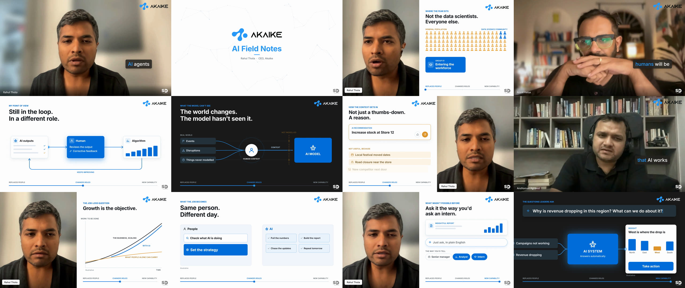

# Story99 — "AI Field Notes" with Rahul Thota

A 2:16 horizontal thought-leadership edit of **Rahul Thota**, CEO of Akaike, cut from a raw 7:44
video call for the **Story99** video-editing test. The conversation is rebuilt so that only Rahul
speaks, with motion graphics that explain his argument rather than repeat it. The cut is word-level
in Python + ffmpeg, the graphics are in [HyperFrames](https://hyperframes.heygen.com) (HTML + GSAP),
and it is rendered to 4K at 60 fps.



| | |
|---|---|
| **Final cut** | [`deliverables/Rahul_Thota_AI_Field_Notes_4K60_SD_v4.mp4`](deliverables/) (3840×2160, 60 fps, 2:16, −15 LUFS, −1.6 dBFS peak, Git LFS) |
| **Hook** | Rahul voicing the fear in the first person: "Am I going to lose my agency?" His answer is held back until after the title |
| **Story** | the fear → "I don't think humans will be out of the loop" → humans as AI's sense organ → the job-loss question → what wasn't possible before → "Now it is possible." |
| **Spine** | a slider on every panel tracks the argument: Replaces People → Changes Roles → New Capability |
| **Style** | matched to the reference from the same interview: Akaike's logo and blue, white and dark panels, boxed word-highlight captions, split speaker layouts, an AI Field Notes title and a blue end card |
| **Other speakers** | four silent listener cutaways, mouths covered, so only Rahul is ever heard. They also hide jump cuts |
| **Music & SFX** | a generated 120 BPM score re-cut on its bar grid to the story's beats; 32 generated sounds across 55 cues, none used more than twice |
| **Picture** | 1080p 24 fps source, reframed per shot, motion-interpolated per shot to 60 fps, upscaled to 4K |
| **Watermark** | SD mark, bottom-right, dark on white panels and white elsewhere |

> The brief is in [`BRIEF.md`](BRIEF.md). The reference study, beat sheet, transitions, music map and
> sound cue sheet are in [`BREAKDOWN.md`](BREAKDOWN.md). Every asset's source and treatment is in
> [`docs/ASSETS.md`](docs/ASSETS.md); the pipeline, version history and gotchas are in
> [`docs/PRODUCTION.md`](docs/PRODUCTION.md).

## The edit in one glance

| Time | Beat | What happens |
|---|---|---|
| 0:00–0:08 | **Hook** | "Am I going to lose my agency? … They'll be able to do everything." Camera pushes in and accelerates into the title |
| 0:08–0:11 | **Title** | AI Field Notes. The logo's blue dot grows until it is the frame |
| 0:11–0:34 | **The fear** | stigma, the general population and not the data scientists: a crowd of people turns amber |
| 0:34–0:48 | **His answer** | "I don't think humans will be out of the loop." The camera follows a feedback loop card by card, then pulls out to show all of it |
| 0:48–1:03 | **Sense organ** | events and disruptions stop at the edge of the model; the human carries them through |
| 1:03–1:17 | **A reason** | a recommendation gets a thumbs-down and three reasons, then "catch those corner cases" |
| 1:17–1:28 | **Job loss** | the business scales past what people alone can carry; the AI line closes the gap |
| 1:28–1:38 | **The new job** | tasks fly from People to AI, then "Set the strategy" arrives |
| 1:38–2:10 | **Not possible before** | ask it the way you'd ask an intern: a typed question, no system in place, then an answer and an action |
| 2:10–2:16 | **Close** | "Now it is possible." Blue end card |

## Project layout

```
story99-rahul/
├── edl.json                    # the cut: every line of the script with its raw time ranges and holds
├── film/                       # the HyperFrames project
│   ├── index.html              # generated by tools/make_comp.py: one timeline, every cue from a word
│   └── assets/                 # SD watermarks (footage, mix and Akaike's logos are built, not committed)
├── assets/audio/               # the generated score and SFX library
├── tools/                      # the build pipeline and the sync checks (see docs/PRODUCTION.md)
├── deliverables/               # final master (v4)                                     [Git LFS]
├── docs/ASSETS.md · docs/PRODUCTION.md · docs/media/stills.jpg
├── raw/ · ref/ · build/ · renders/   # supplied clip, reference, intermediates, drafts  [not in repo]
└── BRIEF.md · BREAKDOWN.md
```

## Rebuild

`raw/rahul.mp4` is the clip Story99 supplied. It is not in this repo, so nothing below runs without it.

```sh
sh tools/prep_raw.sh                 # the two audio tracks the cut reads
python -I tools/fetch_logo.py        # Akaike's logos, from akaike.ai
python -I tools/build_aroll.py       # edl.json → shots and the voice track
python -I tools/frame_aroll.py       # per-shot framing and the 1080p preview footage
python -I tools/align_words.py       # word timings on the edit clock
python -I tools/build_4k60.py interp # 24 → 60 fps per shot (cached, about 1.5 h the first time)
python -I tools/build_4k60.py frame  # reframe to 4K and join with exact timing
python -I tools/check_aroll.py       # prove the footage is in sync before rendering
RES=4k python -I tools/make_comp.py  # film/index.html and the SFX cue list
python -I tools/prep_fx.py           # treat the SFX library
python -I tools/mix_audio.py         # voice, score and SFX → film/assets/mix.wav
cd film && npx hyperframes check && HF_VIDEO_EXTRACTION_MAX_RETRIES=3 HF_SEGMENTED_CAPTURE=true \
  HF_SEGMENT_FRAMES=360 HF_SEGMENT_BROWSER_RECYCLE=1 npx hyperframes render --fps 60 --resolution 4k \
  --quality delivery --workers 1 --low-memory-mode --protocol-timeout 900000 --keep-segments -o ../renders/out.mp4
cd .. && python -I tools/check_sync.py renders/out.mp4
```

Needs Python 3.12 with numpy, opencv-python and faster-whisper, plus ffmpeg and Node.js
(HyperFrames 0.8.226).

## Credits and rights

Built with [Claude Code](https://claude.com/claude-code): the cut, graphics, mix and render pipeline
are code, directed and reviewed by the author.

The interview footage belongs to its owners and was supplied by Story99 for this test; the raw clip
is not committed. Akaike's marks belong to Akaike and are fetched from its website rather than
stored here. The score and sound effects were generated for this project, and the SD watermark is
the author's own.
